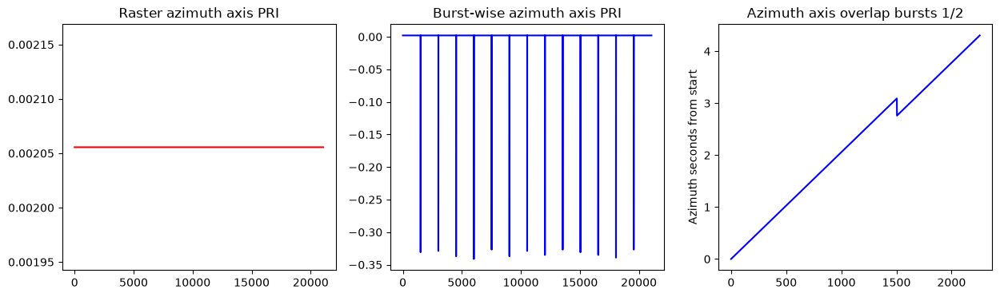
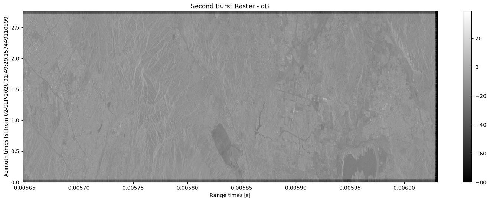

# Working with Product Folders

This example demonstrates how to work with an existing Product Folder, including how to access and interpret its metadata,
locate key information, and read raster data within a specified Region of Interest (ROI).

Here is the download link for the sample data and the following exercise as a Jupyter notebook that can be run locally.

<div class="download-buttons" markdown>

[ :material-download: Download sample data · 4.5 GB ](https://service.aresys.it/downloads-sct-perseo/aresys_io_tutorial_reference_data.zip){ .md-button .button-blue }

[:material-download: Download Jupyter Notebook](../../../assets/notebooks/working_with_existing_pf.ipynb){ .md-button .button-green }

</div>

## Reading Product Folder metadata

``` python
from aresys_io.product import iter_channels, open_product_folder

pf_path = r"aresys_io_tutorial_reference_data/PF"

product = open_product_folder(pf_path)

print(f"Number of channels: {len(product.channel_ids)}\n")

print("Channels overview:\n")
for ch_id, ch_mtd in iter_channels(product):
    print("Channel ID:", ch_id)

    raster_info = ch_mtd.raster_info
    print("   Azimuth Start:", raster_info.lines_start)
    print("   Azimuth Stop:", raster_info.azimuth_axis[-1])
    print("   Duration:", raster_info.azimuth_axis[-1] - raster_info.azimuth_axis[0], "s")
    print("   Range Start:", raster_info.samples_start, "s")
    print("   Range Step:", raster_info.samples_step, "s")
    print("   Lines:", raster_info.lines)
    print("   Samples:", raster_info.samples)

    dataset_info = ch_mtd.dataset_info
    print("   Sensor:", dataset_info.sensor_name)
    print("   Acquisition mode:", dataset_info.acquisition_mode)
    print("   Product type:", dataset_info.image_type)
    print("   Projection:", dataset_info.projection)

    if "SwathInfo" in ch_mtd:
        swath_info = ch_mtd.swath_info
        print("   Swath:", swath_info.swath)
        print("   Polarization:", swath_info.polarization)

    if "BurstInfo" in ch_mtd:
        burst_info = ch_mtd.burst_info
        print("   Number of bursts:", len(burst_info.bursts))
```

You can access specific channel data and metadata with the following snippet.

``` python
# Selecting a single channel and building its azimuth and range axes
from aresys_io.product import read_metadata

channel_id = 2

# retrieving the channel metadata file
channel_metadata_path = product.channel_metadata_path(channel_id)
# reading the metadata file
channel_metadata = read_metadata(channel_metadata_path)
```

## Building burst-wise azimuth axis

For TOPSAR/SCANSAR acquisition modes, data is divided into bursts that are contiguously written on disk but they **may
not be contiguous in time**.

The azimuth time axis for a channel containing bursts could be not monotonic due to bursts overlapping. This must be taken
into account when creating the proper azimuth time axis for the current channel data.

``` python
import matplotlib.pyplot as plt
import numpy as np

raster_info = channel_metadata.raster_info
raster_azimuth_axis = raster_info.azimuth_axis
raster_range_axis = raster_info.range_axis

burst_info = channel_metadata.burst_info
lines_per_burst = burst_info.bursts[0].lines
burst_wise_azimuth_axis = []
for burst in burst_info.bursts:
    burst_wise_azimuth_axis.append(
        np.arange(0, burst.lines, 1) * raster_info.lines_step + burst.azimuth_start_time
    )
burst_wise_azimuth_axis = np.concatenate(burst_wise_azimuth_axis)

print("Raster axis shape:", raster_azimuth_axis.shape)
print("Burst axis shape:", burst_wise_azimuth_axis.shape)

print(np.diff(raster_azimuth_axis).astype(float))
fig, axes = plt.subplots(1, 3, figsize=(15, 4))

axes[0].plot(np.round(np.diff(raster_azimuth_axis).astype(float), 10), "r")
axes[0].set_title("Raster azimuth axis")

axes[1].plot(np.diff(burst_wise_azimuth_axis).astype(float), "b")
axes[1].set_title("Burst-wise azimuth axis")

axes[2].plot(
    burst_wise_azimuth_axis[: lines_per_burst + lines_per_burst // 2] - burst_wise_azimuth_axis[0],
    "b",
)
axes[2].set_title("Azimuth axis overlap bursts 1/2")
axes[2].set_ylabel("Azimuth seconds from start")
```

<figure markdown="span">

{ width="900" }

<figcaption>Difference between raster and burst azimuth axes.</figcaption>

</figure>

## Reading raster data

Now we can show a portion of the channel raster corresponding to the second burst. Plot is in dB to improve the readability
of the raster data.

``` python
# Plotting second burst in DB
from aresys_io.product import read_raster_with_raster_info

# retrieving the channel raster file path
channel_data_path = product.channel_data_path(channel_id)
# reading the burst 2 portion of data raster
second_burst_block = [lines_per_burst, 0, lines_per_burst, raster_info.samples]
second_burst_data = read_raster_with_raster_info(
    channel_data_path, raster_info, second_burst_block
)
second_burst_az_axis = burst_wise_azimuth_axis[lines_per_burst : lines_per_burst * 2 + 1]
# NOTE: creating a relative azimuth time axis for plotting, astype(float) is needed to
# convert object array (due to previous PreciseDateTime data type) to float array
second_burst_az_axis_relative = (second_burst_az_axis - second_burst_az_axis[0]).astype(float)

# plotting the second burst data
second_burst_data_db = 10 * np.log10(abs(second_burst_data) ** 2 + 1e-8)
plt.figure(figsize=(18, 6))
plt.imshow(
    second_burst_data_db,
    cmap="gray",
    aspect="auto",
    extent=[
        raster_range_axis[0],
        raster_range_axis[-1],
        second_burst_az_axis_relative[0],
        second_burst_az_axis_relative[-1],
    ],
    origin="lower",
)
plt.colorbar()
plt.title("Second Burst Raster - dB")
plt.xlabel("Range times [s]")
plt.ylabel(f"Azimuth times [s] from {second_burst_az_axis[0]}")
```

Here is the result:

<figure markdown="span">

{ width="900" }

<figcaption>Simplified quicklook of the second burst data.</figcaption>

</figure>
